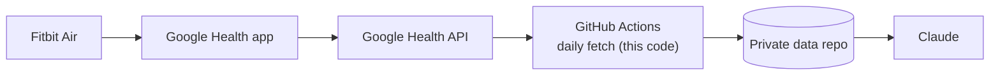

# google-health-claude

Pulls my own Google Health (Fitbit Air) data every day into a private git repo, so I can chat with Claude about training, sleep and recovery with real numbers behind the answers.

**Status:** first version. The code is unit-tested with fake API responses but has not yet been run against live data. First use case: training for my first marathon (Rome, 14 March 2027).

## How it works



| Repository | Visibility | Contains |
|---|---|---|
| `google-health-claude` (this repo) | public | the code and docs, no personal data |
| `google-health-claude-data` | private | the fetched data, the scheduled workflow and the secrets |

The private repo's workflow checks out this repo, runs `fetch` on GitHub's servers every morning and commits the new files. No machine of mine has to be on.

## What gets stored

One JSON file per day and category, holding the raw API objects:

```
daily/YYYY-MM-DD.json     steps, distance, heart rate, resting HR, HRV, SpO2, ...
sleep/YYYY-MM-DD.json     sleep sessions, keyed by the day you woke up
workouts/YYYY-MM-DD.json  exercise sessions
_meta.json                last fetch time and range, any data types the API refused, days to retry
```

Re-fetching is idempotent: data files are rewritten only when their content changes, and new results are merged into what is already stored, so nothing fetched before is ever erased. `_meta.json` records the time of every run, so it changes on each fetch. The daily job re-fetches the last three days because the phone may sync late. `backfill` skips days already stored, except days where a request failed for a temporary reason (timeout, rate limit, server error); those are listed in `_meta.json` and retried.

## Design notes

- **Plain files in git.** Easy for Claude (or any tool) to read, with full history for free.
- **Refresh token as a GitHub secret.** The browser sign-in (`auth`) runs once on a local machine. CI only ever refreshes access tokens.
- **Defensive API handling.** Retries with backoff on 429/5xx and network timeouts, a re-auth on 401, pagination, and per-data-type error isolation: one failing data type is reported but does not fail the run. A reply that does not have the expected shape is reported (key names only) instead of being stored as "no data".
- **Google's docs spell filter fields two ways** (snake_case and camelCase), so each query tries both and remembers which one the API accepts.
- **Read-only scopes only.** Google documents nine read-only scopes, and those are all that is requested.

## Run it yourself

You need your own Google Cloud project with the Google Health API enabled and an OAuth client of type *Desktop app*.

While the OAuth app's publishing status is *Testing*, Google expires its refresh tokens after 7 days, so the daily job would need a new `auth` every week. For an unattended daily job, move the app to *In production*. Check Google's current rules for whether the health scopes then require app verification.

```powershell
# from the repo root: installs the package plus google-auth-oauthlib for `auth`
pip install -e ".[auth]"

# 1. one-time sign-in in your browser; saves a refresh token outside the repo
python -m google_health_claude auth --client-secret path\to\client_secret.json

# 2. check which data types your device supports (prints one line per type)
python -m google_health_claude probe --client-secret path\to\client_secret.json

# 3. fetch the last 3 days, or a longer history
python -m google_health_claude fetch --client-secret path\to\client_secret.json --data-dir path\to\data
python -m google_health_claude backfill --client-secret path\to\client_secret.json --data-dir path\to\data --since 2026-09-01
```

In CI the credentials come from the environment variables `GOOGLE_CLIENT_ID`, `GOOGLE_CLIENT_SECRET` and `GOOGLE_REFRESH_TOKEN`.

Run the tests with `pip install -e ".[dev]"` and `pytest`.

## Privacy

Personal use only. See the [privacy policy](https://eshkurti.github.io/google-health-claude/privacy).

## License

MIT
