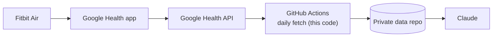

# google-health-claude

Pulls my own Google Health (Fitbit Air) data every day into a private git repo, so I can chat with Claude about training, sleep and recovery with real numbers behind the answers.

**Status:** first version. The code is unit-tested with fake API responses but has not yet been run against live data. First use case: training for my first marathon (Rome, 14 March 2027).

## How it works



| Repository | Visibility | Contains |
|---|---|---|
| `google-health-claude` (this repo) | public | the code and docs, no personal data |
| `google-health-claude-data` | private | the fetched data, the scheduled workflow and the secrets |

The private repo's workflow checks out this repo, runs `fetch` on GitHub's servers every morning and commits the new files. No machine of mine has to be on.

## What gets stored

One JSON file per day and category, holding the raw API objects, plus one TCX file per recorded workout:

```
daily/YYYY-MM-DD.json        steps, distance, heart rate, resting HR, HRV, SpO2, heart-rate
                             zones, run VO2 max, weight (by weigh-in date), ...
sleep/YYYY-MM-DD.json        sleep sessions, keyed by the day you woke up
workouts/YYYY-MM-DD.json     exercise sessions
tcx/YYYY-MM-DD/<id>.tcx.gz   TCX export of a workout (track, heart rate), gzipped
_meta.json                   last fetch time and range, any data types the API refused,
                             days to retry, TCX counts (fetched/skipped/empty/failed)
```

Re-fetching is idempotent: data files are rewritten only when their content changes, and new results are merged into what is already stored, so nothing fetched before is ever erased. `_meta.json` records the time of every run, so it changes on each fetch. The daily job re-fetches the last three days because the phone may sync late. `backfill` skips days already stored, except days where a request failed for a temporary reason (timeout, rate limit, server error); those are listed in `_meta.json` and retried.

Weigh-ins are sparse, so every run lists the last 180 days of weight in one call and merges each weigh-in into its day by timestamp.

After the workouts are stored, a TCX file is downloaded (with `partialData=true`) for each Fitbit workout that was started on the band, and for auto-detected workouts other than walks. Health Connect copies and passive walks are skipped. A reply without trackpoints is not stored and is tried again on the next run; a stored file is downloaded again only if the workout's end time changed. The gzip header has a fixed timestamp, so the same reply gives the same bytes and no git diff as long as the Python and zlib build stay the same (other builds compress the same content into different bytes).

## Derived tables

`derive` turns the raw files into analysis-ready CSV tables, offline. It writes `workouts`, `run_splits`, `run_facts`, `personal_bests`, `daily`, `weight`, `sleep`, `sleep_stages`, `weekly` and `quality`, plus a `schema.md` describing every column. With `--sqlite` it also builds all tables in one SQLite file with foreign keys enforced, plus `exercise_points` (TCX points without coordinates). An empty `notes.csv` template is created once for hand-written notes and never overwritten.

- **Deduplicated workouts.** Only Fitbit records become rows. Health Connect copies are counted on the session they overlap, and same-type Fitbit records whose intervals overlap are merged into one.
- **No coordinates.** TCX positions are only checked for presence (`has_gps`). Latitude and longitude are never read into any output.
- **Time-based, not count-based.** Sampling is irregular (1–3 s steps in passive sessions, gaps in GPS runs), so heart rate is time-weighted and speeds and durations come from timestamps. GPS segments break at gaps, so speed, walking time and smoothed altitude never bridge one.
- **Honest blanks.** Numbers stored as strings and `"123s"` durations become numbers, and units go into column names. Times are in Europe/Berlin. A missing value stays empty and is never written as 0. The last three days are flagged as partial.
- **Weigh-ins in their own table.** `weight` lists every weigh-in, including the 180-day lookback, with same-day duplicates merged. Days and weeks that only have a weigh-in get no rows in `daily`, `quality` or `weekly`.
- **Byte-stable.** Unchanged input gives identical CSV files.

## Design notes

- **Plain files in git.** Easy for Claude (or any tool) to read, with full history for free.
- **Refresh token as a GitHub secret.** The browser sign-in (`auth`) runs once on a local machine. CI only ever refreshes access tokens.
- **Defensive API handling.** Retries with backoff on 429/5xx and network timeouts, a re-auth on 401, pagination, and per-data-type error isolation: one failing data type is reported but does not fail the run. A reply that does not have the expected shape is reported (key names only) instead of being stored as "no data".
- **Google's docs spell filter fields two ways** (snake_case and camelCase), so each query tries both and remembers which one the API accepts.
- **Read-only scopes only.** Google documents nine read-only scopes, and those are all that is requested.

## Try it without a Fitbit

`demo` writes invented data in exactly the layout `fetch` produces: six weeks of a beginner's marathon build (3-4 runs a week with a growing long run, weekly strength, passive walks, daily heart rate, HRV, SpO2, sleep and a few weigh-ins). The GPS track is an invented lake loop with a short climb. The same seed gives the same content on every platform, and the same bytes on the same Python and zlib build. No account, no token, no network:

```powershell
pip install -e .
python -m google_health_claude demo --out demo-data              # --seed N, --weeks 3-26
python -m google_health_claude derive --data-dir demo-data --out demo-derived --sqlite demo.sqlite
```

The demo deliberately includes every awkward case `derive` handles: Health Connect copies and a run recorded twice, a GPS gap, a run after midnight that falls on another UTC date, the switch from summer time, a day without data, a sick day with resting-HR and HRV outliers, partial last days, an empty TCX export, and numbers stored as strings.

## Run it yourself

You need your own Google Cloud project with the Google Health API enabled and an OAuth client of type *Desktop app*.

While the OAuth app's publishing status is *Testing*, Google expires its refresh tokens after 7 days, so the daily job would need a new `auth` every week. For an unattended daily job, move the app to *In production*. Check Google's current rules for whether the health scopes then require app verification.

```powershell
# from the repo root: installs the package plus google-auth-oauthlib for `auth`
pip install -e ".[auth]"

# 1. one-time sign-in in your browser; saves a refresh token outside the repo
python -m google_health_claude auth --client-secret path\to\client_secret.json

# 2. check which data types your device supports (prints one line per type)
python -m google_health_claude probe --client-secret path\to\client_secret.json

# optional: export a stored GPS run, strength session and passive walk as TCX and
# describe the files (structure only; raw replies go to the git-ignored samples\tcx)
python -m google_health_claude probe-tcx --client-secret path\to\client_secret.json --data-dir path\to\data

# optional: try heart-rate samples of the latest run, heart-rate zones, body metrics
# and every other readable data type (terminal output only, no values)
python -m google_health_claude probe-more --client-secret path\to\client_secret.json --data-dir path\to\data

# 3. fetch the last 3 days, or a longer history
python -m google_health_claude fetch --client-secret path\to\client_secret.json --data-dir path\to\data
python -m google_health_claude backfill --client-secret path\to\client_secret.json --data-dir path\to\data --since 2026-09-01

# 4. build the derived tables (no network; keep the output out of public repos)
python -m google_health_claude derive --data-dir path\to\data --out path\to\derived --sqlite path\to\health.sqlite
```

In CI the credentials come from the environment variables `GOOGLE_CLIENT_ID`, `GOOGLE_CLIENT_SECRET` and `GOOGLE_REFRESH_TOKEN`.

Run the tests with `pip install -e ".[dev]"` and `pytest`. A golden test pins the whole pipeline: `tests/golden/raw` is `demo --seed 1 --weeks 3`, and `tests/golden/expected` is what `derive` makes of it. Text files are compared byte for byte, TCX files by their decompressed content (the gzip bytes vary between Python builds), SQLite through queries. After an intended change, regenerate with `pytest tests/test_golden.py --update-golden` and commit the golden files on their own.

`scripts/compare_real.py --raw PATH --ref TAG [--ref2 TAG_OR_FOLDER]` runs `derive` from two code versions on the same data in temporary git worktrees. It prints only file names, row counts and how many lines differ, never a value, so it is safe on real data.

## Privacy

Personal use only. See the [privacy policy](https://eshkurti.github.io/google-health-claude/privacy).

## License

MIT
